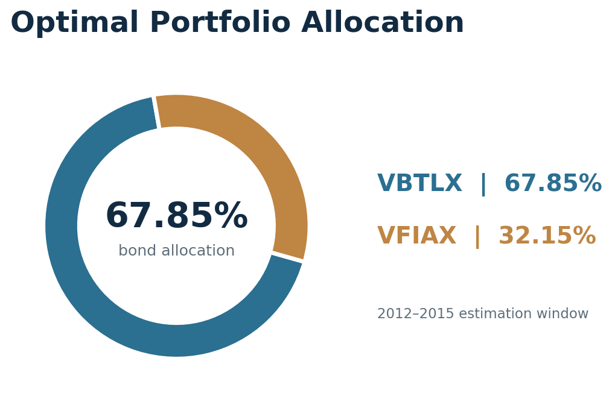
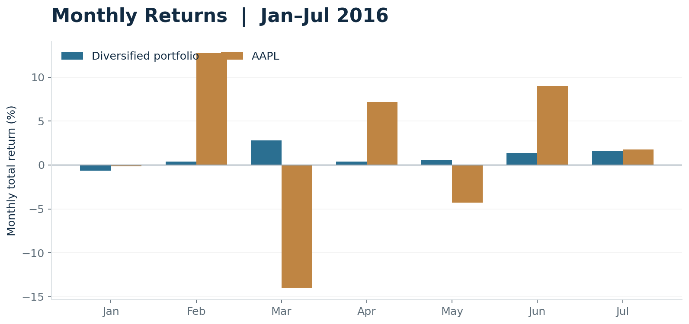
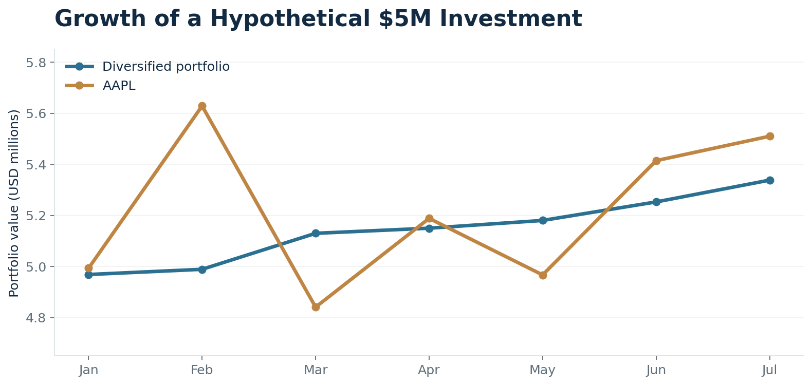

# Portfolio Performance & Diversification Analysis

**Wharton Business and Financial Modeling Capstone | Independent academic project | September 2026**

**Author:** Yavuz Kaan Aksoy  
**Tools:** Microsoft Excel (Solver) · Financial Modeling · PowerPoint · Risk & Return Analysis  
**Project type:** Historical portfolio optimization, performance analysis, and client-facing presentation

> **Executive insight:** A diversified VBTLX/VFIAX portfolio earned less than AAPL over January–July 2016, but experienced substantially lower month-to-month volatility. The exercise demonstrates how investment objectives and risk tolerance shape asset allocation decisions.

[**View the original 5-slide project presentation (PDF) ↗**](presentation/Wharton_Capstone_Portfolio_Presentation.pdf) &nbsp;·&nbsp; [Download editable PowerPoint](presentation/Wharton_Capstone_Portfolio_Presentation.pptx) &nbsp;·&nbsp; [Methodology](docs/METHODOLOGY.md)

---

## Project at a glance

| Portfolio design | Out-of-sample comparison | Core observation |
|:---|:---|:---|
| **$5 million** hypothetical allocation | **Jan–Jul 2016** | Diversification lowered observed volatility |
| **67.85% VBTLX / 32.15% VFIAX** | **6.77%** diversified return vs **10.21%** AAPL | **1.11%** vs **9.04%** monthly volatility |

This is a **historical course case study** using a 2012–2015 estimation window. It is not a current investment strategy, backtested trading service, or investment recommendation.

## Business question

How should a hypothetical $5 million portfolio be allocated between a bond index fund (VBTLX) and an equity index fund (VFIAX) to balance return and risk? How does the resulting mix compare with holding a single equity (AAPL) during a later seven-month observation window?

## Approach

1. **Prepare historical data:** Review monthly total returns for VBTLX and VFIAX (January 2012–December 2015) from the course dataset.
2. **Optimize allocation:** Use Excel Solver to maximize the historical Sharpe ratio, assuming a **0% risk-free rate**, **100% allocation**, and a **long-only** portfolio.
3. **Evaluate subsequent performance:** Apply fixed portfolio allocation weights to reported monthly returns for **January–July 2016**; compare them with AAPL.
4. **Communicate findings:** Build a client-facing slide deck with allocation, performance, volatility, and a risk-sensitive recommendation.

> **Scope note:** The original Excel Solver workbook was not retained. The 67.8459% / 32.1541% allocation has been independently checked using the course-provided monthly fund return workbook. The results below are taken from the author's presentation and also checked against the monthly return series embedded in its charts. A verification script is included, but the licensed course-provided raw dataset is **not redistributed** here.

## Portfolio construction



| Asset | Weight | Hypothetical initial allocation |
|:---|---:|---:|
| VBTLX — Vanguard Total Bond Market Index | 67.85% | $3,392,295 |
| VFIAX — Vanguard 500 Index | 32.15% | $1,607,705 |
| **Total** | **100.00%** | **$5,000,000** |

## Performance & risk: January–July 2016

| Metric | Diversified portfolio | AAPL |
|:---|---:|---:|
| Cumulative return | **+6.77%** | +10.21% |
| Monthly volatility (sample standard deviation) | **1.11%** | 9.04% |
| Worst monthly return | **−0.62%** | −13.99% |
| Hypothetical ending value | **$5.338M** | $5.510M |





**Interpretation:** AAPL delivered a higher cumulative return within this seven-month sample. However, the diversified portfolio showed materially lower variability and a smaller worst monthly loss. The appropriate choice depends on the investor's time horizon and capacity for loss, not on return alone.

## Deliverables and repository contents

```text
.
├── README.md
├── presentation/
│   ├── Wharton_Capstone_Portfolio_Presentation.pdf
│   └── Wharton_Capstone_Portfolio_Presentation.pptx
├── assets/
│   ├── portfolio_allocation.png
│   ├── monthly_returns_comparison.png
│   └── cumulative_performance.png
├── data/
│   ├── README.md
│   ├── reported_monthly_returns_2016.csv
│   └── performance_summary.csv
├── docs/
│   ├── METHODOLOGY.md
│   └── REPRODUCIBILITY.md
├── scripts/
│   ├── recalculate_performance.py
│   └── optimize_allocation.py
└── requirements.txt
```

The standalone scripts are supplementary **reproducibility aids created for this portfolio repository**, not claims that they were part of the originally submitted Excel-based course project.

## Skills demonstrated

**Quantitative analysis:** historical returns, risk / return comparison, Sharpe ratio, asset allocation, Excel Solver.  
**Communication:** translating complex numeric findings into visuals and a stakeholder-ready presentation.  
**Business judgment:** assessing alternatives against client objectives, documenting assumptions and limitations.

---

**Education:** University of Pennsylvania (Wharton) — Business and Financial Modeling Specialization, completed 2026 through Coursera.  
**Author profile:** [GitHub](https://github.com/yavuzaksoyy06-create) · [LinkedIn](https://www.linkedin.com/in/yavuz-kaan-aksoy-1b41a0366/)

*For educational purposes only. Past performance does not guarantee future results. This is independent student work, not an official research publication or an investment recommendation from Wharton or the University of Pennsylvania.*
